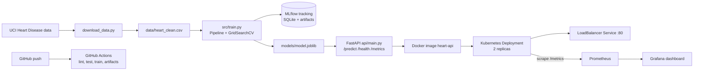

# Heart Disease Risk Prediction: End-to-End MLOps

A reproducible ML pipeline that predicts heart disease risk from patient health data, served as a containerised FastAPI service on Kubernetes, with CI/CD, experiment tracking and monitoring.

**Repository:** https://github.com/2025ae05981-debug/heart-disease-mlops
**Demo video:** [Watch the pipeline demo](https://github.com/2025ae05981-debug/heart-disease-mlops/blob/main/video/pipeline_demo.mp4)
**Course:** MLOps (AIMLCZG523), Assignment 01
**Report:** [Final report (PDF)](report/MLOps_Assignment1_Report.pdf)

---

## 1. Architecture



## 2. Repository layout

```
heart-disease-mlops/
├── data/                 raw and cleaned dataset
├── notebooks/            01_eda.ipynb
├── src/                  preprocessing.py, train.py, predict.py
├── api/                  FastAPI app (main.py)
├── tests/                pytest unit tests
├── k8s/                  deployment.yaml, service.yaml
├── monitoring/           Prometheus, Grafana, headless service, dashboard JSON
├── models/               model.joblib (trained pipeline)
├── screenshots/          eda, training, mlflow, cicd, docker, k8s, monitoring
├── .github/workflows/    ci.yml
├── Dockerfile
├── requirements.txt      full dev/training environment
├── requirements-api.txt  slim serving environment
└── download_data.py
```

## 3. Setup (Windows, PowerShell)

Prerequisites: Python 3.13, Git, Docker Desktop (WSL2 backend, Kubernetes enabled).

```powershell
git clone https://github.com/2025ae05981-debug/heart-disease-mlops.git
cd heart-disease-mlops
python -m venv venv
venv\Scripts\activate
pip install -r requirements.txt
```

Download and clean the data:

```powershell
python download_data.py
```

Train, tune and track the models:

```powershell
python -m src.train
mlflow ui --backend-store-uri sqlite:///mlflow.db    # http://localhost:5000
```

Run tests and lint:

```powershell
python -m pytest tests -v
flake8 src tests api download_data.py --max-line-length=100
```

## 4. Data, EDA and modelling

- **Data:** UCI Heart Disease (Cleveland subset, 303 patients, 13 features). The target is binarised: 0 = no disease (164), 1 = disease (139). Classes are close to balanced, so no resampling is used.
- **EDA** (`notebooks/01_eda.ipynb`, figures in `screenshots/eda/`): class balance, histograms by target, categorical features vs target and a correlation heatmap. Strongest correlations with the target: `thal`, `ca`, `exang`, `oldpeak`, `cp` (positive) and `thalach` (negative). `chol` and `fbs` are weak on their own.
- **Preprocessing** (`src/preprocessing.py`): one `ColumnTransformer`. Numeric features are median-imputed and standardised. Categorical features are mode-imputed and one-hot encoded. Imputation sits inside the pipeline, so it is fitted on training folds only (no leakage).
- **Models:** Logistic Regression and Random Forest, each tuned with `GridSearchCV` (ROC-AUC, stratified 5-fold CV) on an 80/20 stratified split.

| Model | CV ROC-AUC (5-fold) | Test ROC-AUC | Best parameters |
|---|---|---|---|
| Logistic Regression | 0.902 | 0.966 | `C=1` |
| Random Forest | 0.898 | 0.955 | `max_depth=None`, `min_samples_split=5`, `n_estimators=100` |

Logistic Regression was selected. The two models are close in CV, and the test set is small (61 patients), so the CV figures are the more reliable estimate.

## 5. Experiment tracking (MLflow)

Each run logs parameters, CV and test metrics (accuracy, precision, recall, F1, ROC-AUC), a confusion matrix, an ROC curve and the fitted pipeline. The tracking backend is SQLite (`mlflow.db`), because MLflow 3.x puts the file store in maintenance mode. Screenshots are in `screenshots/mlflow/`.

## 6. Model packaging

The saved artifact is the whole scikit-learn `Pipeline` (preprocessing and model) in `models/model.joblib`, so training and serving apply identical transformations. Dependencies are pinned in `requirements.txt`. A clean-environment install followed by `python -m src.predict` was verified.

## 7. CI/CD (GitHub Actions)

`.github/workflows/ci.yml` runs on every push and pull request to `main`: install, flake8, pytest, model training, then upload of test results, model and plots as artifacts. Any failing step fails the run. Run #2 failed on lint errors in a stray file and run #3 fixed it. See `screenshots/cicd/`.

## 8. API and container

```powershell
docker build -t heart-api:latest .
docker run -d -p 8000:8000 --name heart-api heart-api:latest
```

| Endpoint | Purpose |
|---|---|
| `GET /health` | liveness and readiness |
| `POST /predict` | JSON in, prediction and confidence out |
| `GET /metrics` | Prometheus metrics |
| `GET /docs` | interactive Swagger UI |

Sample request:

```powershell
$body = '{"age":63,"sex":1,"cp":1,"trestbps":145,"chol":233,"fbs":1,"restecg":2,"thalach":150,"exang":0,"oldpeak":2.3,"slope":3,"ca":0,"thal":6}'
Invoke-RestMethod -Uri http://localhost:8000/predict -Method Post -ContentType "application/json" -Body $body
```

Sample response: `{"prediction": 0, "confidence": 0.8345, "probability_disease": 0.1655}`. Invalid input is rejected with HTTP 422 and a descriptive message.

## 9. Kubernetes deployment

Local cluster: Docker Desktop (kubeadm).

```powershell
kubectl apply -f k8s\deployment.yaml
kubectl apply -f k8s\service.yaml
kubectl get pods
kubectl get service heart-api-service
```

- 2 replicas with readiness and liveness probes on `/health`, plus CPU and memory requests and limits.
- `LoadBalancer` service on port 80 forwarding to container port 8000, reachable at `http://localhost`.
- If port 80 is unavailable: `kubectl port-forward service/heart-api-service 8080:80`, then use `http://localhost:8080`.

## 10. Monitoring and logging

- Every request is logged (method, path, status, latency) and each prediction is logged with its confidence.
- The API exposes `api_requests_total`, `api_request_latency_seconds` and `api_predictions_total`.
- Prometheus scrapes both pods through a headless service. Grafana shows request rate, predictions by class, average and p95 latency, and error responses.

```powershell
kubectl apply -f monitoring\headless-service.yaml
kubectl apply -f monitoring\prometheus.yaml
kubectl apply -f monitoring\grafana.yaml
```

Prometheus: http://localhost:9090 | Grafana: http://localhost:3000 (admin / admin, local demo only). Import `monitoring/grafana-dashboard.json` to restore the dashboard.

## 11. Access instructions (local)

The API is deployed locally, not on a public URL. After the steps in section 9 it is available at `http://localhost` (or `http://localhost:8080` via port-forward).
